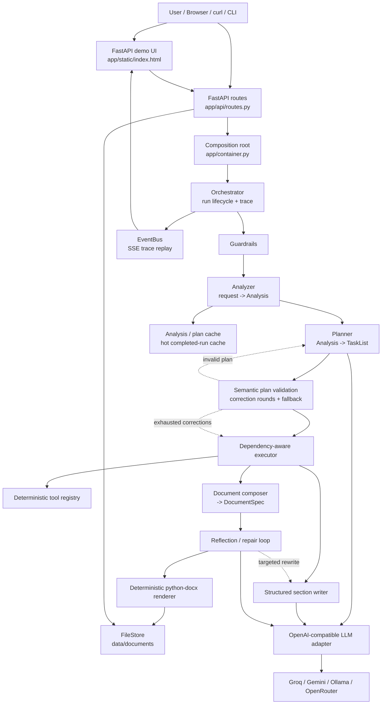
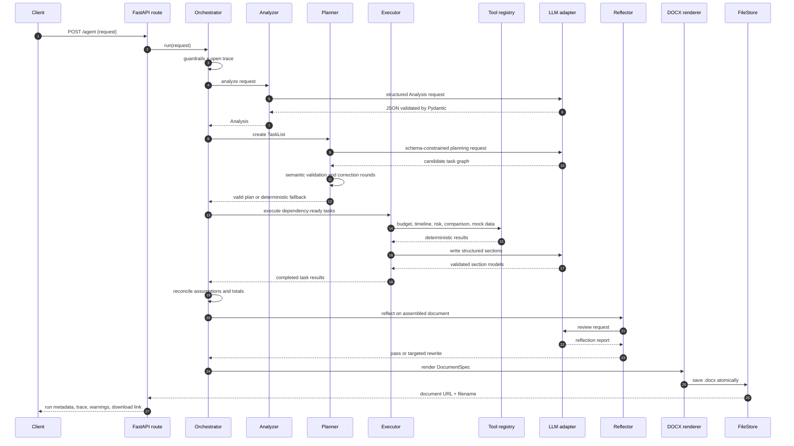

# Productivity

**Productivity** is an autonomous business-document agent. It converts a natural-language request into a structured, reviewed, downloadable Microsoft Word document.

The system does not use a hard-coded template-only workflow. It analyzes the request, identifies missing information and conflicts, asks a configured LLM to create a validated task graph, executes deterministic business tools, writes structured document sections, self-checks the draft, and renders the final `.docx` with Python.

> **Important design boundary:** the LLM never writes Word XML or `.docx` binary content. The LLM returns validated Pydantic data; the deterministic renderer owns document formatting and file creation.

## Contents

- [What the project does](#what-the-project-does)
- [Why it is built this way](#why-it-is-built-this-way)
- [Architecture](#architecture)
- [How a request works](#how-a-request-works)
- [Repository structure](#repository-structure)
- [Requirements](#requirements)
- [Installation](#installation)
- [Configuration](#configuration)
- [Choosing an LLM provider](#choosing-an-llm-provider)
- [Running the application](#running-the-application)
- [Using the browser demo](#using-the-browser-demo)
- [Using the CLI](#using-the-cli)
- [Using the HTTP API](#using-the-http-api)
- [Understanding the output](#understanding-the-output)
- [Reliability, validation, and recovery](#reliability-validation-and-recovery)
- [Caching and demo performance](#caching-and-demo-performance)
- [Docker](#docker)
- [Testing and development](#testing-and-development)
- [Troubleshooting](#troubleshooting)
- [Security and operational notes](#security-and-operational-notes)
- [Design decisions and trade-offs](#design-decisions-and-trade-offs)
- [Roadmap](#roadmap)
- [Documentation](#documentation)

## What the project does

A user supplies a request such as:

> Create a project plan for launching a customer-support chatbot at a mid-size retailer, including a budget, timeline, risks, and recommendation.

Productivity produces:

1. A typed analysis of the request.
2. Explicit assumptions, missing information, and conflicts.
3. A dependency-aware task plan.
4. Results from deterministic business tools such as budget, timeline, risk, option-comparison, template, and mock-data tools.
5. Structured document sections written with the configured LLM.
6. A reflection/self-check report and any bounded repair attempts.
7. A styled `.docx` file with a cover page, metadata, contents, headings, tables, callouts, page numbers, assumptions, and generated content.
8. Trace events that make the run observable in the browser, API response, and SSE stream.

The application is intentionally a **modular monolith**. It is easy to run locally and easy to demonstrate, while its internal boundaries are clear enough to extract workers or services later.

## Why it is built this way

The project focuses on the part of document automation that is easy to underestimate: producing a useful and trustworthy artifact, not merely generating fluent text.

- **Natural-language input:** users do not need to know the document schema in advance.
- **Structured intermediate state:** analysis, plans, tool results, sections, and reflection reports are typed models rather than loose dictionaries.
- **Autonomous planning:** the LLM chooses a task graph from the request and registered tools.
- **Deterministic business logic:** calculations and document rendering are performed by Python code where reproducibility matters.
- **Visible assumptions:** unresolved inputs are surfaced instead of silently invented.
- **Bounded recovery:** invalid plans and failed provider calls have retry, correction, fallback, and warning paths.
- **Provider flexibility:** the application uses an OpenAI-compatible adapter for Groq, Gemini, Ollama, and OpenRouter.
- **Local testability:** the test suite uses `FakeLLM`, so tests do not require a network connection or paid API credits.

## Architecture

### System view



### Component responsibilities

| Component | Responsibility | Main location |
| --- | --- | --- |
| FastAPI application | Starts the service, builds dependencies, serves the UI, and exposes HTTP routes | `app/main.py`, `app/api/` |
| Settings | Loads and validates environment configuration | `app/core/config.py` |
| Container | Composes the LLM, registry, renderer, file store, caches, and event bus | `app/container.py` |
| Guardrails | Rejects or sanitizes unsafe, empty, or oversized requests | `app/agent/guardrails.py` |
| Analyzer | Converts the request into a typed `Analysis` | `app/agent/analyzer.py` |
| Planner | Produces and validates a typed `TaskList` | `app/agent/planner.py` |
| Executor | Runs dependency-ready tasks with bounded concurrency and retries | `app/agent/executor.py` |
| Tool registry | Exposes deterministic business tools to the planner/executor | `app/tools/` |
| Composer | Builds a structured `DocumentSpec` from completed work | `app/agent/composer.py` |
| Reflector | Reviews the draft and requests targeted repairs when appropriate | `app/agent/reflector.py` |
| LLM adapter | Handles provider compatibility, JSON extraction, retries, pacing, and tiered models | `app/llm/` |
| Renderer | Converts validated document data into a styled Word file | `app/render/` |
| File store | Saves documents atomically and assigns readable filenames | `app/infra/filestore.py` |
| Cache | Reuses analysis/plans and can replay completed demo runs | `app/infra/cache.py` |
| Event bus | Publishes replayable run events for SSE clients | `app/infra/events.py` |

### Request lifecycle



## How a request works

### 1. Request validation and guardrails

The request enters through `POST /agent`, `POST /runs`, the browser demo, or the CLI. Guardrails validate the text, enforce `MAX_REQUEST_CHARS`, sanitize the accepted value, and record non-fatal flags as warnings.

### 2. Analysis

The analyzer creates an `Analysis` model containing information such as:

- Document type.
- Objective.
- Intended audience.
- Complexity.
- Known facts.
- Missing information.
- Conflicting constraints.
- Explicit assumptions.

This analysis is the shared context for planning and later document composition.

### 3. Planning

The planner asks the configured LLM for a `TaskList`. Each task includes a type, title, dependencies, acceptance criteria, and either a tool or document section target.

The plan is checked twice:

1. **Schema validation:** the response must parse as the Pydantic task-list model.
2. **Semantic validation:** task IDs must be unique, dependencies must exist and be acyclic, tools must be registered, required sections must be covered, and render work must not be delegated to the LLM.

If the model returns a syntactically valid but semantically invalid plan, the planner requests a bounded correction. If correction attempts are exhausted, a deterministic fallback plan is used and the response contains a warning.

### 4. Dependency-aware execution

The executor repeatedly selects tasks whose dependencies are complete. Independent tasks can run concurrently up to `MAX_CONCURRENCY`. Tool tasks call deterministic Python implementations; writing tasks call the LLM and validate the resulting section models.

The executor records task status and trace events such as queued, running, completed, retried, corrected, or failed.

### 5. Reconciliation

After tools execute, financial assumptions and generated budget tables are reconciled. This prevents a document from showing a total that disagrees with its line items or from silently retaining stale assumptions after tool results are available.

### 6. Composition

The composer builds a `DocumentSpec`. This is the renderer-facing model containing the title, metadata, sections, tables, callouts, assumptions, and other document blocks. The model is independent of Word XML.

### 7. Reflection and repair

The reflector checks the assembled document for issues such as missing required content, unsupported claims, budget inconsistencies, and weak recommendations. Depending on `REFLECTION_LLM_MODE`, it can be disabled, run automatically for complex cases, or always run.

If a repair is justified, only the affected section is rewritten. Reflection is bounded by `MAX_REFLECTION_LOOPS` and `REFLECTION_TIMEOUT_S`; if the budget expires, the current validated draft is still rendered and the unresolved item is included in `warnings`.

### 8. Deterministic Word rendering

The renderer creates the final `.docx` with `python-docx`. It controls:

- Cover page and metadata.
- Heading hierarchy.
- Paragraph spacing and line height.
- Tables, cell padding, alternating rows, and repeated headers.
- Visible contents.
- Word TOC fields and bookmarks.
- Page references and footer page numbers.
- Assumption and warning callouts.
- Human-readable filenames such as `customer-support-chatbot-project-plan-709eb0e9.docx`.

## Repository structure

```text
.
├── app/
│   ├── agent/                 # guardrails, analysis, planning, execution, composition, reflection
│   ├── api/                   # FastAPI routes, auth, and HTTP schemas
│   ├── core/                  # settings, errors, logging
│   ├── infra/                 # cache, events, file storage
│   ├── llm/                   # provider adapter, fallback, metadata, contracts
│   ├── models/                # shared Pydantic/domain models
│   ├── prompts/               # prompt templates
│   ├── render/                # Word document styles and renderer
│   ├── static/                # browser demo
│   ├── tools/                 # deterministic business tools and registry
│   └── main.py                # FastAPI application factory/lifecycle
├── examples/                  # ready-made JSON requests and a sample document
├── scripts/
│   ├── demo.py                # run a real provider from the command line
│   ├── prewarm.py             # populate the completed-run hot cache
│   ├── render_demo.py         # render a deterministic local demo document
│   ├── ping_llm.py            # provider connectivity check
│   └── build_portfolio_pdf.py # build the portfolio PDF from Markdown
├── tests/                     # unit, integration, HTTP, renderer, and deployment tests
├── docs/                      # video script, test-input guide, and portfolio write-up
├── data/                      # runtime output; created when the app runs
├── Dockerfile
├── docker-compose.yml
├── Makefile
├── pyproject.toml
└── .env.example
```

## Requirements

### Required for local development

- Python `3.11`, `3.12`, or `3.13`.
- Git.
- Internet access only if using a hosted LLM provider.

### Optional

- An API key for Groq, Gemini, or OpenRouter.
- [Ollama](https://ollama.com/) for local inference.
- Docker and Docker Compose.
- Microsoft Word or LibreOffice for opening generated `.docx` files.

The test suite does not require a hosted provider because it uses `FakeLLM`.

## Installation

### macOS, Linux, or Git Bash

```bash
git clone https://github.com/N0AHZACH/productivity.git
cd productivity

python3 -m venv .venv
source .venv/bin/activate

python -m pip install --upgrade pip
python -m pip install -e ".[dev]"
cp .env.example .env
```

### Windows PowerShell

```powershell
git clone https://github.com/N0AHZACH/productivity.git
Set-Location productivity

py -3.12 -m venv .venv
.\.venv\Scripts\Activate.ps1

python -m pip install --upgrade pip
python -m pip install -e ".[dev]"
Copy-Item .env.example .env
```

If PowerShell blocks activation, either allow local scripts for the current user or invoke the environment directly with `.venv\Scripts\python.exe`.

After installation, open `.env` and choose a provider as described below. The application can start without an API key, but an LLM-backed run requires either a valid hosted-provider key or a reachable Ollama server.

## Configuration

Configuration is loaded by `pydantic-settings` from `.env` and environment variables. Environment variables take precedence over values in the file.

### Minimum hosted-provider setup

For Groq:

```dotenv
PRIMARY_PROVIDER=groq
GROQ_API_KEY=your_key_here
MODEL_FAST=openai/gpt-oss-20b
MODEL_STRONG=openai/gpt-oss-120b
```

For Gemini:

```dotenv
PRIMARY_PROVIDER=gemini
GEMINI_API_KEY=your_key_here
MODEL_FAST=gemini-3.5-flash-lite
MODEL_STRONG=gemini-3.5-flash-lite
```

Model identifiers and free-tier availability change over time. Use the model names currently accepted by the provider account you are using.

### Configuration reference

#### Provider and model selection

| Variable | Default | Meaning |
| --- | --- | --- |
| `PRIMARY_PROVIDER` | `groq` | `groq`, `gemini`, `ollama`, or `openrouter` |
| `FALLBACK_PROVIDER` | empty | Optional second provider after primary retries are exhausted |
| `GROQ_API_KEY` | empty | Groq credential |
| `GEMINI_API_KEY` | empty | Gemini credential |
| `OPENROUTER_API_KEY` | empty | OpenRouter credential |
| `OLLAMA_API_KEY` | `ollama` | Local-server placeholder; Ollama normally does not require a key |
| `GROQ_BASE_URL` | Groq OpenAI endpoint | Provider endpoint override |
| `GEMINI_BASE_URL` | Gemini OpenAI-compatible endpoint | Provider endpoint override |
| `OPENROUTER_BASE_URL` | OpenRouter endpoint | Provider endpoint override |
| `OLLAMA_BASE_URL` | `http://localhost:11434/v1` | Local Ollama endpoint |
| `MODEL_FAST` | `openai/gpt-oss-20b` | Lower-cost/faster tier |
| `MODEL_STRONG` | `openai/gpt-oss-120b` | Higher-quality tier |
| `ANALYSIS_TIER` | `fast` | Model tier for request analysis |
| `PLANNING_TIER` | `fast` | Model tier for task planning |
| `WRITING_TIER` | `strong` | Model tier for section writing |
| `REFLECTION_TIER` | `strong` | Model tier for self-review |
| `COMPOSITION_TIER` | `fast` | Model tier for document composition |
| `CORRECTION_TIER` | `fast` | Model tier for plan/output correction |

#### LLM behavior and quotas

| Variable | Default | Meaning |
| --- | --- | --- |
| `LLM_SUPPORTS_JSON_MODE` | `true` | Whether the provider supports JSON response mode |
| `LLM_TIMEOUT_S` | `60` | Timeout for one provider call |
| `LLM_MAX_RETRIES` | `3` | Maximum retry attempts for transient failures |
| `LLM_MAX_OUTPUT_TOKENS` | `4096` | Output budget sent to the provider |
| `LLM_REASONING_EFFORT` | empty | Optional provider-specific reasoning setting |
| `LLM_MIN_INTERVAL_S` | `0` | Minimum delay between provider calls; useful for free-tier RPM limits |
| `MAX_CONCURRENCY` | `4` | Concurrent LLM/tool tasks |
| `RUN_TIMEOUT_S` | `120` | Total bound for one agent run |

#### Agent behavior and storage

| Variable | Default | Meaning |
| --- | --- | --- |
| `MAX_REQUEST_CHARS` | `4000` | Maximum accepted request size |
| `MAX_REFLECTION_LOOPS` | `2` | Maximum targeted reflection repairs |
| `REFLECTION_LLM_MODE` | `auto` | `off`, `auto`, or `always` |
| `REFLECTION_TIMEOUT_S` | `180` | Reflection budget |
| `DATA_DIR` | `./data` | Runtime storage root; documents go under `documents/` |
| `DEFAULT_AUTHOR` | `Productivity` | Default author metadata in generated Word files |
| `API_KEYS` | empty | Comma-separated values required in `X-API-Key` when non-empty |
| `CACHE_ENABLED` | `true` | Enable analysis/plan cache |
| `CACHE_TTL_S` | `3600` | Analysis/plan cache lifetime |
| `CACHE_MAX_ENTRIES` | `256` | Analysis/plan cache size bound |
| `HOT_CACHE_ENABLED` | `true` | Enable completed-run replay cache |
| `HOT_CACHE_TTL_S` | `86400` | Completed-run replay lifetime |
| `HOT_CACHE_MAX_ENTRIES` | `8` | Completed-run replay cache size |

## Choosing an LLM provider

All supported providers use the same internal `OpenAICompatClient` interface. The application therefore keeps planning, writing, retries, JSON repair, and model-tier routing independent of the provider.

### Groq

```dotenv
PRIMARY_PROVIDER=groq
GROQ_API_KEY=...
MODEL_FAST=openai/gpt-oss-20b
MODEL_STRONG=openai/gpt-oss-120b
```

### Gemini

```dotenv
PRIMARY_PROVIDER=gemini
GEMINI_API_KEY=...
MODEL_FAST=gemini-3.5-flash-lite
MODEL_STRONG=gemini-3.5-flash-lite
```

### OpenRouter

```dotenv
PRIMARY_PROVIDER=openrouter
OPENROUTER_API_KEY=...
MODEL_FAST=dots-studio/dots-3-note-preview:free
MODEL_STRONG=dots-studio/dots-3-note-preview:free
LLM_REASONING_EFFORT=none
```

Free-model pools and rate limits vary. A provider may return a valid HTTP response but still fail to produce useful structured output; semantic validation and fallback behavior are designed for that case.

### Ollama

Install and start Ollama, then pull an instruction model:

```bash
ollama pull qwen2.5:7b-instruct
ollama list
```

Set:

```dotenv
PRIMARY_PROVIDER=ollama
OLLAMA_BASE_URL=http://localhost:11434/v1
OLLAMA_API_KEY=ollama
MODEL_FAST=qwen2.5:7b-instruct
MODEL_STRONG=qwen2.5:7b-instruct
```

## Running the application

Start the development server:

```bash
uvicorn app.main:app --reload --host 0.0.0.0 --port 8000
```

Or use the Makefile:

```bash
make run
```

Open:

- Demo: <http://localhost:8000/>
- Alternate demo route: <http://localhost:8000/demo>
- Swagger/OpenAPI: <http://localhost:8000/docs>
- ReDoc: <http://localhost:8000/redoc>
- Liveness: <http://localhost:8000/health>
- Readiness: <http://localhost:8000/ready>

The health endpoint only proves that the process is alive. The readiness endpoint confirms that application settings and document storage can be loaded. A provider key is checked when a run actually calls the configured provider.

## Using the browser demo

1. Start the server.
2. Open <http://localhost:8000/>.
3. Enter a request or choose one of the provided presets.
4. Submit the request.
5. Watch the live trace as analysis, planning, tools, writing, reflection, rendering, and storage complete.
6. Review the generated plan, assumptions, conflicts, warnings, and reflection results.
7. Click **Download Word document**.

The demo uses the same API and orchestration path as the CLI. It is not a mocked presentation layer.

## Using the CLI

Run one of the checked-in examples:

```bash
python scripts/demo.py --example examples/standard_request.json
python scripts/demo.py --example examples/complex_request.json
python scripts/demo.py --example examples/smoke_request.json
```

The CLI prints a JSON summary containing the run ID, status, output path, plan source, number of sections, reflection status, and warnings.

The request files are ordinary JSON objects:

```json
{
  "request": "Create a project plan for launching a customer-support chatbot at a mid-size retailer, including a budget, timeline, risks, and recommendation."
}
```

Create a custom request:

```bash
python scripts/demo.py --example path/to/my_request.json
```

For a deterministic local rendering check that does not need a live provider:

```bash
python scripts/render_demo.py
```

## Using the HTTP API

### Synchronous run: `POST /agent`

```bash
curl -X POST http://localhost:8000/agent \
  -H "Content-Type: application/json" \
  --data @examples/standard_request.json
```

If `API_KEYS` is configured, add:

```bash
-H "X-API-Key: your-configured-key"
```

The synchronous endpoint waits until the run completes or fails. A successful response contains the complete plan and trace.

### Background run: `POST /runs`

```bash
curl -X POST http://localhost:8000/runs \
  -H "Content-Type: application/json" \
  --data @examples/complex_request.json
```

Example response:

```json
{
  "run_id": "8d7f...",
  "status": "queued",
  "events_url": "/runs/8d7f.../events"
}
```

The endpoint returns `202 Accepted` immediately. The run continues in the application background task.

### Stream progress: `GET /runs/{run_id}/events`

```bash
curl -N http://localhost:8000/runs/8d7f.../events
```

The response is Server-Sent Events. Each event has a sequence ID and JSON data containing the stage, message, duration, and stage-specific details. The event stream is replayable for the lifetime of the in-memory event bus.

### Download the document: `GET /documents/{run_id}`

```bash
curl -L http://localhost:8000/documents/8d7f... \
  -o generated-document.docx
```

The response uses the Word MIME type and a readable `Content-Disposition` filename. The stable API lookup key is the run ID; the download filename is derived from the document title.

### Operational endpoints

| Method | Path | Purpose |
| --- | --- | --- |
| `GET` | `/` or `/demo` | Browser demo |
| `GET` | `/health` | Liveness probe |
| `GET` | `/ready` | Readiness and storage check |
| `POST` | `/agent` | Synchronous full run |
| `POST` | `/runs` | Start background run |
| `GET` | `/runs/{run_id}/events` | Replay/live SSE events |
| `GET` | `/documents/{run_id}` | Download generated Word file |
| `GET` | `/docs` | Swagger UI |
| `GET` | `/redoc` | ReDoc API reference |

### Error shape

Application errors use a stable structure:

```json
{
  "error": {
    "code": "GUARDRAIL_REJECTED",
    "message": "The request is too long.",
    "request_id": "..."
  }
}
```

Common failure categories include invalid requests, provider errors, invalid LLM output, timeouts, missing runs, and missing documents.

## Understanding the output

The API response is intentionally transparent. Important fields include:

| Field | Meaning |
| --- | --- |
| `run_id` | Stable identifier used for events and document download |
| `status` | `completed`, `completed_with_warnings`, or a failure state |
| `plan_source` | `llm` or `fallback` |
| `plan_source_detail` | Human-readable provider/model or fallback explanation |
| `analysis` | Typed request interpretation |
| `plan` | Validated task graph and task statuses |
| `assumptions` | Assumptions made because the request was incomplete |
| `conflicts` | Conflicting or incompatible constraints found in the request |
| `reflection` | Self-check reports and repair results |
| `warnings` | Non-fatal issues, fallbacks, or unresolved review items |
| `trace` | Ordered lifecycle events with timing and stage data |
| `document_url` | Relative download endpoint |
| `filename` | Human-readable generated filename |

The generated document is stored under `DATA_DIR/documents/`. Storage uses an atomic write path so a reader does not receive a partially-written document.

## Reliability, validation, and recovery

The project has several layers of defense because a provider can return a response that is valid JSON but still unusable.

### LLM output handling

- Pydantic schemas define expected JSON contracts.
- JSON mode can be enabled or disabled per provider.
- Fenced or mixed model output is extracted before validation.
- Invalid structured output can be repaired up to a bounded number of attempts.
- Provider calls use timeouts, retry classification, exponential jitter, and `Retry-After` handling.
- Calls are paced with `LLM_MIN_INTERVAL_S` to reduce free-tier burst failures.
- Optional fallback providers can be used after primary-provider retries are exhausted.

### Plan validation

The planner verifies more than syntax:

- Required sections are present.
- Tool names exist in the registry.
- Dependencies reference real task IDs.
- The dependency graph is acyclic.
- Task kinds match their required fields.
- The plan does not ask the LLM to write binary document output.
- Acceptance criteria are present for actionable work.

### Execution recovery

- Dependency-ready tasks are scheduled rather than executed in arbitrary order.
- Tool and writing tasks have bounded retries/correction paths.
- Failed work is represented in task status and warnings.
- Total runs are bounded by `RUN_TIMEOUT_S`.
- Reflection is bounded separately so a review cannot stall document delivery indefinitely.
- A deterministic fallback plan keeps the system demonstrable when planning output cannot be validated.

### Deterministic rendering

The LLM produces content models; Python renders the Word file. This makes formatting, page fields, tables, metadata, and file storage testable without relying on model behavior.

## Caching and demo performance

There are two in-memory cache layers:

1. **Analysis/plan cache:** keyed by normalized request, guardrail context, planner configuration, and registered tool context.
2. **Hot completed-run cache:** stores a completed run and document bytes for exact-repeat demo requests.

To prewarm the standard and complex examples after starting the server:

```bash
python scripts/prewarm.py
```

To prewarm a different server:

```bash
python scripts/prewarm.py --url http://127.0.0.1:8000
```

The hot cache is a local demonstration optimization. It is bounded, in-memory, and not a replacement for durable production storage.

## Docker

### Build and run the image

```bash
docker build -t docpilot:latest .
docker run --rm -p 8000:8000 --env-file .env -v docpilot-data:/data docpilot:latest
```

The image uses Python 3.12, runs as a non-root `docpilot` user, exposes port `8000`, writes runtime files to `/data`, and includes a health check against `/health`.

### Docker Compose

```bash
docker compose up --build
```

Compose reads `.env`, exposes the app on port `8000`, and persists `/data` in the `docpilot-data` volume. The optional Ollama service is documented in `docker-compose.yml` but commented out by default so hosted-provider and local-provider setups remain separate.

## Testing and development

### Run the standard checks

```bash
python -m pytest -q
ruff check .
mypy .
```

Or use the project targets:

```bash
make test
make lint
make typecheck
make fmt
```

The test suite uses `FakeLLM` and does not call hosted providers. It covers:

- Configuration validation.
- Guardrails and analyzer behavior.
- Planner schema/semantic validation.
- Executor dependency ordering and retries.
- Tool calculations and reconciliation.
- Reflection behavior.
- Cache behavior.
- File-store naming and atomic writes.
- DOCX rendering, contents, bookmarks, page references, and tables.
- HTTP health/readiness routes.
- Full end-to-end runs that render and download real `.docx` files.
- Deployment/Docker configuration checks.

### Build the portfolio PDF

The detailed project-management case study is generated from Markdown:

```bash
make portfolio-pdf
```

This runs `scripts/build_portfolio_pdf.py` and writes `docs/PROJECT_PORTFOLIO.pdf`.

### Add a new deterministic tool

1. Create the tool implementation under `app/tools/`.
2. Give it a typed input and output model.
3. Register it in the default registry.
4. Update the planner's semantic validation expectations if the tool has special constraints.
5. Add unit tests for normal and boundary cases.
6. Add or update an end-to-end request if the tool changes the user-visible document.

### Add or change a document block

1. Update the domain/document model.
2. Update the composer to produce the block.
3. Update the renderer and styles.
4. Add renderer assertions that inspect the generated `.docx` XML or extracted text.
5. Run the full test, lint, and type-check commands.

## Troubleshooting

### The app starts but `/agent` fails immediately

Check:

```bash
curl http://localhost:8000/ready
```

Then verify `.env`:

- `PRIMARY_PROVIDER` is one of `groq`, `gemini`, `ollama`, or `openrouter`.
- The matching API key is set for hosted providers.
- `OLLAMA_BASE_URL` is reachable when using Ollama.
- `MODEL_FAST` and `MODEL_STRONG` are valid for the selected provider.

### Provider rate limits or HTTP 429 responses

Reduce concurrency and add pacing:

```dotenv
MAX_CONCURRENCY=1
LLM_MIN_INTERVAL_S=4.2
LLM_MAX_OUTPUT_TOKENS=2048
```

The exact values depend on the provider's current limits. A fallback provider can also be configured.

### The model returns invalid JSON

The adapter extracts JSON and attempts bounded repair. If planning still fails, the run uses the deterministic fallback plan and reports the reason in `plan_source_detail` and `warnings`. If this happens frequently, use a stronger model for `PLANNING_TIER`, lower temperature in the implementation, or choose a model with reliable structured-output behavior.

### Reflection makes runs too slow

Use:

```dotenv
REFLECTION_LLM_MODE=off
```

or reduce `MAX_REFLECTION_LOOPS` and `REFLECTION_TIMEOUT_S`. Reflection is best-effort; disabling it does not disable the core document workflow.

### The browser shows an old result instantly

This is usually the completed-run hot cache. Run a different request, disable it temporarily, or clear the process by restarting the server:

```dotenv
HOT_CACHE_ENABLED=false
```

### Generated documents are not where expected

Check `DATA_DIR`. The default is `./data`, and generated files are under `./data/documents/`. In Docker, `DATA_DIR` is `/data` and should be mounted as a volume.

### Windows virtual-environment activation fails

Use the interpreter directly:

```powershell
.\.venv\Scripts\python.exe -m pip install -e ".[dev]"
.\.venv\Scripts\python.exe -m uvicorn app.main:app --reload
```

## Security and operational notes

- Do not commit `.env`, provider keys, generated runtime data, or private prompts containing secrets.
- `API_KEYS` provides a simple local/shared-environment header check; it is not a complete identity system.
- Hosted-provider requests may contain business information. Use an approved provider and data policy for sensitive workloads.
- The default file store is local and in-memory caches are process-local. Use durable storage and a shared event/state layer before deploying multiple replicas.
- Provider usage, output quality, quotas, and model IDs are external dependencies and can change.
- The app intentionally exposes warnings and fallback metadata so an operator can distinguish an LLM plan from a degraded deterministic plan.

## Design decisions and trade-offs

### Modular monolith instead of multiple services

This keeps setup, debugging, and local demonstrations simple. The boundaries are still explicit: orchestration, tools, LLM access, rendering, storage, and events can be extracted later if scale requires it.

### One orchestrated agent instead of a multi-agent network

A planner/writer flow with deterministic tools has lower latency, fewer coordination failures, and easier traceability than many autonomous agents exchanging messages. The trade-off is less role specialization.

### Pydantic contracts at every boundary

Typed models make invalid intermediate state visible and allow the test suite to exercise the workflow without a provider. The trade-off is more schema maintenance when the document model evolves.

### Deterministic tools and rendering

Budget math, timelines, reconciliation, and Word formatting belong in code. The LLM supplies interpretation and prose, while code owns repeatable outcomes.

### In-memory cache for the demo

The cache makes repeated recording/demo requests fast without introducing Redis or another service. It is intentionally not presented as production durability.

## Roadmap

Potential production-oriented extensions include:

- Durable run state and artifact storage.
- Authentication backed by an identity provider.
- Persistent event streaming for multiple API replicas.
- Human approval checkpoints before rendering or download.
- Versioned document templates and organization themes.
- Provider usage/cost dashboards.
- Background worker execution with a durable queue.
- Additional export formats such as PDF and Markdown.
- Retrieval over approved company knowledge sources.

## Documentation

- [`docs/PROJECT_PORTFOLIO.md`](docs/PROJECT_PORTFOLIO.md) — detailed project-management and architecture case study.
- [`docs/PROJECT_PORTFOLIO.pdf`](docs/PROJECT_PORTFOLIO.pdf) — rendered portfolio report.
- [`docs/video_script.md`](docs/video_script.md) — recording and demonstration script.
- [`docs/demo_test_inputs.md`](docs/demo_test_inputs.md) — demo input guidance.
- [`examples/standard_request.json`](examples/standard_request.json) — normal project-plan request.
- [`examples/complex_request.json`](examples/complex_request.json) — ambiguity, conflicts, options, and recommendation request.
- [`examples/smoke_request.json`](examples/smoke_request.json) — short smoke-test request.

## Maintainer

Built and maintained by [Noah Zach](https://github.com/N0AHZACH).
