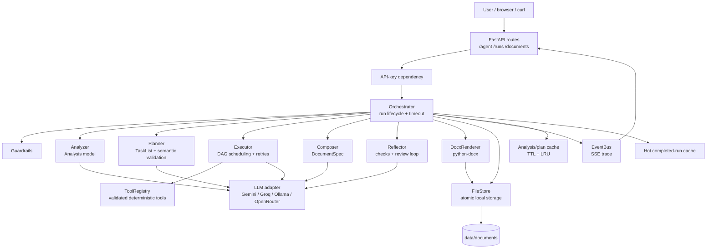

# Productivity — Autonomous Business-Document Agent

## Project-manager portfolio case study

**Project status:** Demonstrable local MVP / portfolio-ready prototype  
**Product:** Productivity  
**Primary outcome:** Convert one natural-language business request into a planned,
reviewed, polished Microsoft Word document.  
**Delivery surface:** FastAPI API, browser demo, CLI runner, Docker image, and
downloadable `.docx` output.  
**Current provider for the live demo:** Gemini through an OpenAI-compatible API
adapter. The application also supports Groq, Ollama, and OpenRouter.

> This document is both a portfolio narrative and an operator guide. It explains
> what was built, why each major decision was made, how the system works, how to
> run it, how it was tested, and what I would do next in a production program.

---

## 1. Executive summary

Productivity is an autonomous document-production system designed around a simple
business outcome: a user should be able to describe a document in plain language
and receive a useful Word deliverable without manually decomposing the work.

The agent accepts a request such as:

> Prepare a board-level decision memo on replacing our legacy billing platform.
> The deadline, compliance scope, and budget are not fully known. Compare credible
> options and recommend a prioritized path.

Instead of treating that input as a single text-generation prompt, Productivity
turns it into a controlled workflow:

1. **Guardrails validate the request.** The system rejects out-of-scope requests,
   limits request size, and records suspicious input flags.
2. **Analysis creates a structured brief.** The agent identifies document type,
   objective, audience, facts, missing information, conflicts, assumptions, and
   complexity.
3. **Planning creates a task graph.** The configured LLM produces a typed `TaskList`
   containing tool calls, analysis steps, section-writing steps, dependencies, and
   acceptance criteria.
4. **Semantic validation checks the plan.** The plan must use registered tools,
   cover the document template, address conflicts, and avoid delegating file
   rendering to the LLM. Invalid plans receive correction rounds before the safe
   deterministic fallback is used.
5. **Execution orchestrates work.** Independent tasks run concurrently within a
   bounded semaphore. Dependency-ready tasks run as soon as their prerequisites
   finish.
6. **Deterministic tools provide evidence.** Budget, timeline, risk, option
   comparison, template, and mock-data tools produce JSON-safe results.
7. **LLM writing produces typed section drafts.** The model writes validated
   `SectionDraft` objects, not Word XML or binary document content.
8. **Composition assembles the document.** An executive summary, recommendations,
   assumptions, and completed sections are assembled into a `DocumentSpec`.
9. **Reflection performs a self-check.** Deterministic checks and optional LLM
   review identify missing sections, thin content, placeholders, and inconsistent
   totals. The agent can rewrite affected sections.
10. **The renderer creates the Word file.** `python-docx` deterministically renders
    a styled `.docx` with cover page, metadata, visible contents, headings, tables,
    callouts, bookmarks, page references, and footer numbering.

The core engineering principle is **LLM for interpretation and language; typed
Python and deterministic tooling for control, evidence, validation, and rendering**.

### Portfolio headline

> I built a schema-driven autonomous agent that converts ambiguous business briefs
> into auditable task plans, executes tool-backed work with recovery paths, reviews
> its own output, and delivers a polished Word document through a FastAPI service.

---

## 2. Business problem and opportunity

### The problem

Business-document work is often fragmented across several manual activities:

- A stakeholder writes an incomplete request.
- A project manager interprets the objective and asks follow-up questions.
- An analyst gathers budget, timeline, risk, or option information.
- A writer structures the result into an executive-friendly narrative.
- Someone manually formats the final Word document.
- A reviewer checks whether the document is complete and internally consistent.

This process is slow, difficult to standardize, and vulnerable to omissions. A
language model can write prose quickly, but a single prompt does not provide enough
control over planning, evidence, correction, document structure, or operational
visibility.

### The opportunity

Productivity treats document production as a small project-delivery workflow. The
agent is responsible for creating its own work breakdown, choosing tools, making
explicit assumptions, surfacing conflicts, and producing a reusable artifact.

That creates a useful middle ground between:

- a rigid form-driven workflow that cannot handle ambiguity; and
- an unconstrained chatbot that produces attractive but unreliable prose.

### Intended users

| User | Need | Value delivered |
| --- | --- | --- |
| Project manager | Turn a brief into a delivery-ready plan | Tasks, dependencies, risks, budget, timeline, next steps |
| Product manager | Compare options and recommend a path | Decision memo with assumptions and trade-offs |
| Operations lead | Convert rough notes into a structured artifact | Meeting minutes, owners, actions, and open questions |
| Technical lead | Produce a design or implementation document | Typed sections, evidence tables, risks, and governance |
| Executive sponsor | Review a concise decision artifact | Executive summary, recommendation, assumptions, and traceability |

---

## 3. Goals, non-goals, and success measures

### Goals

1. Accept a natural-language request through `POST /agent`.
2. Demonstrate autonomous planning rather than a single hard-coded template.
3. Make the generated task list visible to the user.
4. Use deterministic tools for evidence-producing work.
5. Handle ambiguous requests through explicit assumptions and conflict analysis.
6. Recover from invalid LLM plans, invalid tool arguments, and review findings.
7. Produce a polished `.docx` without allowing the LLM to write binary output.
8. Support a live browser demo and a scriptable API.
9. Keep the system runnable with free-tier or locally hosted models.
10. Provide enough traceability for a reviewer to understand what happened.

### Non-goals for this version

- Connecting to production ERP, CRM, ticketing, or finance systems.
- Treating mock data as real company data.
- Guaranteeing regulatory or financial advice.
- Building a multi-tenant SaaS control plane.
- Supporting arbitrary file formats beyond the Word output path.
- Replacing a human approval process for high-impact decisions.

### Success measures

| Measure | Target / evidence |
| --- | --- |
| End-to-end completion | A valid business request produces a downloadable `.docx` |
| Planning visibility | API and UI expose typed tasks, dependencies, statuses, and acceptance criteria |
| Ambiguity handling | Complex input produces assumptions, missing information, conflicts, and a recommendation |
| Document quality | Output contains structured sections, tables, callouts, page furniture, and a usable contents view |
| Reliability | Invalid plans receive correction rounds or deterministic fallback; tool failures do not silently disappear |
| Testability | Offline test suite uses `FakeLLM` and does not require network access |
| Demo speed | Exact-repeat requests replay from the hot cache in approximately hundredths of a second after prewarming |
| Maintainability | LLM, tools, orchestration, rendering, storage, and API layers have explicit boundaries |

---

## 4. Scope and deliverables

### Delivered scope

- FastAPI service and OpenAPI documentation.
- Interactive browser demo with SSE progress updates.
- Synchronous `/agent` endpoint.
- Background `/runs` endpoint with replayable event stream.
- Local document storage with safe run IDs and atomic writes.
- Readable download filenames derived from document titles.
- Provider-neutral LLM client interface.
- OpenAI-compatible adapter for Gemini, Groq, Ollama, and OpenRouter.
- Provider fallback circuit-breaker wrapper.
- Request guardrails and standardized error responses.
- Analysis, planning, execution, composition, reflection, and rendering stages.
- Seven deterministic tools registered through a schema-aware registry.
- Bounded LRU/TTL analysis-plan cache.
- Completed-run hot cache for fast exact-repeat demos.
- Prewarm script for recording sessions.
- Styled Word document renderer.
- Offline tests, end-to-end tests, Dockerfile, and Docker Compose configuration.

### Primary user journey


---

## 5. Architecture overview

### Architectural style

The system is a modular monolith with explicit ports and adapters:

- **FastAPI** is the delivery interface.
- **Orchestrator** owns the end-to-end workflow and run lifecycle.
- **Pydantic models** are the contracts between stages.
- **LLM client protocol** isolates provider-specific behavior.
- **Tool registry** exposes deterministic capabilities to the planner and executor.
- **Renderer** converts validated document data into Word output.
- **File store** owns persistence and download naming.
- **Event bus** provides observable progress for the browser and background API.

This was intentionally chosen over a distributed microservice architecture. The
assignment requires a complete autonomous flow, and a modular monolith provides
fast local iteration, lower operational overhead, and easier debugging while still
leaving clear seams for future extraction.

### Component diagram



### Repository map

```text
app/
├── main.py                 FastAPI factory, lifecycle, request IDs
├── container.py            Dependency composition root
├── api/
│   ├── routes.py           HTTP, SSE, health, and document routes
│   ├── schemas.py          Request/response contracts
│   └── auth.py             Optional API-key enforcement
├── agent/
│   ├── guardrails.py       Input limits and scope checks
│   ├── analyzer.py         Natural language -> Analysis
│   ├── planner.py          Analysis -> validated TaskList
│   ├── executor.py         Dependency scheduling and retries
│   ├── composer.py         Section drafts -> DocumentSpec
│   ├── reflector.py        Review and repair loop
│   ├── checks.py           Deterministic document checks
│   ├── reconcile.py        Budget and assumption reconciliation
│   └── orchestrator.py     End-to-end run coordination
├── llm/
│   ├── base.py             Provider-neutral protocol
│   ├── factory.py          Provider construction
│   ├── openai_compat.py    Retries, JSON repair, rate-limit handling
│   ├── fallback.py         Secondary provider and circuit breaker
│   ├── fake.py             Offline test double
│   └── metadata.py         Human-readable provider/model labels
├── tools/                  Budget, schedule, risks, comparisons, templates, mock data
├── models/                 Pydantic analysis, plan, state, and document contracts
├── render/                 Word styles, themes, fields, and deterministic renderer
├── infra/                  Cache, events, and local file store
├── core/                   Settings, errors, logging
└── static/index.html       Browser demo
```

---

## 6. End-to-end workflow

### Stage 1 — Request validation and guardrails

The request enters through a Pydantic `AgentRequest` with a minimum length. The
guardrail layer also enforces the configured maximum request length and checks for
patterns such as prompt-injection language. Flags do not automatically reject a
request; they become context for the analyzer so the model treats embedded text as
untrusted data.

Out-of-scope requests, such as a request to write a poem rather than a business
document, return a structured error instead of silently producing an unrelated
artifact.

### Stage 2 — Structured analysis

The analyzer makes one schema-constrained LLM call and returns an `Analysis` model:

```python
class Analysis(BaseModel):
    doc_type: DocType
    objective: str
    audience: str
    known_facts: list[str]
    missing_info: list[str]
    conflicts: list[str]
    assumptions: list[str]
    complexity: str
    in_scope: bool
```

The analyzer then backfills explicit assumptions for uncovered missing information.
For example, if a request mentions a budget but does not provide a ceiling, the
document can say that a working budget of `120,000 USD` is being assumed and must be
confirmed before approval. This is more useful than pretending the missing input
does not exist.

### Stage 3 — Autonomous task planning

The planner receives the analysis, the registered tool catalog, JSON Schemas, and a
document-type template. The LLM returns a `TaskList` with tasks such as:

- Estimate delivery budget.
- Build delivery timeline.
- Generate risk register.
- Compare options.
- Write objectives and success criteria.
- Write scope and deliverables.
- Write risks and mitigations.
- Write dependencies and next steps.

Each task contains:

- stable ID such as `t1`;
- title and description;
- task kind: `tool`, `analysis`, or `write_section`;
- tool name and JSON arguments when applicable;
- section title when writing;
- dependencies;
- acceptance criterion;
- status, attempts, result, and error fields.

The planner validates more than JSON syntax. It checks that:

1. The document type matches analysis.
2. The number of tasks is bounded.
3. At least three writing tasks exist.
4. Every tool exists in the registry.
5. Every tool argument validates against the tool's Pydantic schema.
6. Recommended sections are covered or explicitly omitted with a reason.
7. Conflicts are addressed by a task about options, trade-offs, or priorities.
8. The plan does not delegate rendering, exporting, or file creation to the LLM.

The planner has up to two correction rounds. If the output remains invalid, a
deterministic fallback plan is used and the API response includes a warning.

### Stage 4 — Tool orchestration and execution

The executor treats the plan as a dependency graph. It launches all ready tasks,
limits concurrency with `MAX_CONCURRENCY`, waits for the first completed task, and
then schedules newly unblocked tasks.

The scheduling behavior is deliberately project-manager-like: independent evidence
gathering can happen in parallel, while writing waits until the relevant evidence
exists. A blocked task is marked skipped with an explanation rather than silently
being dropped.

The tool registry validates input before execution, executes sync tools in a worker
thread, awaits async tools, and verifies that the result is JSON-safe.

### Stage 5 — Typed section writing

Section writers receive the analysis, task description, acceptance criterion, and
dependency results. The LLM returns a `SectionDraft` model made of typed blocks:

- paragraph;
- heading;
- bullet list;
- numbered list;
- table;
- callout;
- page break.

If a section draft fails validation, it receives one bounded correction attempt. The
renderer never needs to parse arbitrary prose or markdown into a Word file.

### Stage 6 — Composition and reconciliation

The composer creates an executive summary and recommendation, orders sections using
the document template, carries assumptions forward, and creates a `DocumentSpec`.

Budget totals are reconciled after tool execution and again immediately before
rendering. This protects against a review rewrite accidentally leaving a stale total
in a budget table.

### Stage 7 — Reflection and self-check

The reflector runs deterministic checks for:

- missing required sections;
- placeholders such as `TBD`;
- thin sections;
- missing or inconsistent tables;
- unresolved budget totals;
- missing conflict coverage.

The optional LLM critic produces a typed `CriticReview`. If actionable issues are
found, the system maps them back to section tasks and requests targeted rewrites.
Reflection is bounded by `MAX_REFLECTION_LOOPS` and `REFLECTION_TIMEOUT_S`. If the
review budget expires, the current validated draft is still rendered and the
unresolved issue is placed in `warnings`.

### Stage 8 — Deterministic Word rendering

`DocxRenderer` owns the binary output. It configures Word styles, page margins,
headers, footers, page fields, visible contents, bookmarks, page references, tables,
callouts, and cover metadata.

The cover includes readable AI metadata such as:

- planner provider/model/tier;
- writer provider/model/tier;
- author;
- date;
- version;
- document type.

The generated filename is title-derived and collision-resistant, for example:

```text
legacy-billing-platform-replacement-decision-memo-87f4920c.docx
```

The stable run ID remains the API lookup key, while the download is understandable
to a human.

---

## 7. Tool catalog

The registered tools are pure, schema-validated business capabilities:

| Tool | Purpose | Example output |
| --- | --- | --- |
| `estimate_budget` | Calculate role costs, extras, contingency, and total | Line items, subtotal, contingency, total |
| `build_timeline` | Build a weekend-aware phase schedule | Start/end dates, phases, milestones |
| `generate_risk_register` | Select relevant risks from a deterministic library | Likelihood, impact, score, rating, mitigation |
| `compare_options` | Rank options using weighted criteria | Normalized weights, matrix, ranking, missing scores |
| `get_company_profile` | Provide clearly-labelled fictional organization context | Mock company profile and disclaimer |
| `get_team_roster` | Provide deterministic fictional team members | Mock team roster and disclaimer |
| `get_section_template` | Expose required sections for each document type | Section titles and writing guidance |

The registry is intentionally explicit. A planner can discover tools through their
names, descriptions, and JSON Schemas, but it cannot invoke an unregistered tool.

---

## 8. API and integration design

### Synchronous endpoint

```http
POST /agent
Content-Type: application/json

{"request":"Write a project plan for launching a support chatbot."}
```

The response includes:

- `run_id`;
- `status`;
- `analysis`;
- `plan_source`;
- `plan_source_detail` such as `gemini / gemini-3.5-flash-lite (fast)`;
- complete `plan` with task statuses;
- assumptions;
- conflicts;
- reflection reports;
- warnings;
- trace events;
- `document_url`;
- readable `filename`.

### Background endpoint and SSE

```http
POST /runs
Content-Type: application/json

{"request":"Prepare a board-level decision memo..."}
```

The API returns `202 Accepted` with a `run_id` and `events_url`. The browser uses:

```http
GET /runs/{run_id}/events
Accept: text/event-stream
```

Every trace event includes a stage, message, timestamp, optional duration, and
stage-specific data. This makes the agent observable as it works instead of forcing
the user to wait behind an opaque spinner.

### Operational endpoints

| Endpoint | Purpose |
| --- | --- |
| `GET /` or `GET /demo` | Browser demo |
| `GET /health` | Liveness check |
| `GET /ready` | Storage/config readiness check |
| `GET /docs` | FastAPI Swagger UI |
| `GET /documents/{run_id}` | Download generated Word file |

### Error contract

Errors use a consistent envelope:

```json
{
  "error": {
    "code": "GUARDRAIL_REJECTED",
    "message": "Request is outside Productivity's scope.",
    "request_id": "..."
  }
}
```

This is important for a future UI, CLI, or workflow engine because callers do not
need to parse framework-specific error shapes.

---

## 9. LLM strategy and model governance

### Provider abstraction

Application code depends on the `LLMClient` protocol rather than on Gemini, Groq,
OpenRouter, or Ollama directly. The OpenAI-compatible adapter centralizes:

- async calls;
- model tier routing;
- concurrency limiting;
- request pacing;
- retryable error classification;
- provider retry hints;
- JSON extraction;
- schema validation;
- JSON repair prompts;
- usage accounting hooks.

### Model tiers

The configuration separates work by cost and capability:

| Stage | Default tier | Reason |
| --- | --- | --- |
| Analysis | Fast | Structured interpretation is compact |
| Planning | Fast | Plan validation and correction bound risk |
| Writing | Strong | Section quality benefits from more capability |
| Reflection | Strong | Review benefits from critical reasoning |
| Composition | Fast | Summary is constrained by completed sections |
| Correction | Fast | Repairs are narrow and schema-driven |

### Free/local execution options

The project supports:

- Gemini free tier;
- Groq free tier;
- local Ollama;
- OpenRouter free-model routes.

Provider selection is environment-driven. Secrets remain in `.env`, which is
excluded from the Docker context and should never be committed.

### Reliability controls

The system uses several bounded controls rather than trusting the model blindly:

- schema-constrained responses;
- semantic plan validation;
- JSON repair rounds;
- tool argument correction;
- section rewrite retries;
- provider fallback;
- circuit breaker for repeated primary-provider failures;
- request/run/reflection timeouts;
- warning propagation instead of silent degradation.

---

## 10. Caching and demo performance

There are two cache layers:

### Analysis and plan cache

Normalized request analysis and validated LLM plans are cached with TTL and bounded
LRU behavior. This avoids repeating expensive planning calls when a request is
re-submitted during development.

### Hot completed-run cache

The hot cache stores a completed validated state plus rendered document bytes for
exact-repeat requests. On a cache hit, the agent replays meaningful stages—analysis,
plan, execution, composition, reflection, render, and store—without calling the
provider again. The user still receives a fresh run ID and readable filename.

To prepare a recording:

```bash
uvicorn app.main:app --reload --host 0.0.0.0 --port 8000
python scripts/prewarm.py
```

The first execution warms the cache. The same standard and complex requests then
complete in approximately `0.02` seconds in the local demo environment.

This is a deliberate demo optimization, not a claim that arbitrary new requests
will complete that quickly. New requests still follow the full provider-backed
workflow.

---


The generated document is designed to look like a business deliverable rather than
raw model output.

### Layout elements

- branded cover page;
- author, date, version, document type, and AI model metadata;
- visible contents table;
- Word TOC field configured to refresh on open;
- bookmarks and page-reference fields;
- hierarchy-aware headings;
- restrained page margins and paragraph spacing;
- alternating table rows;
- repeated table headers;
- decision, warning, risk, and information callouts;
- page number and page count footer fields;
- assumptions/open-questions panel;
- deterministic core document properties.

### Why the LLM does not write the `.docx`

Allowing the model to generate raw Word XML would make the output difficult to
validate, insecure to reason about, and inconsistent across runs. Instead, the
model returns typed content blocks. The renderer decides how those blocks look.

This separation gives the project manager two kinds of confidence:

1. **Content confidence:** the document sections are based on validated model output,
   deterministic tools, and review checks.
2. **Presentation confidence:** the same renderer produces consistent document
   structure and formatting for every request.

---


### Scenario A — Standard project plan

Input:

```text
Write a project plan for launching a customer support chatbot at a mid-size retail
company. The target is a twelve-week launch with a team of five, working within a
fixed operating budget. Include the budget, delivery timeline, risks, and immediate
next steps.
```

Expected behavior:

1. Analyze the request as a project plan.
2. Plan budget, timeline, and risk tools.
3. Execute independent tools in parallel.
4. Write the project-plan sections.
5. Include budget and schedule tables.
6. Review the draft.
7. Download a file such as `customer-support-chatbot-project-plan-xxxxxxx.docx`.

What to point out in a portfolio demo:

- task list appears before the document is complete;
- tasks show dependency relationships;
- plan source identifies provider and model;
- the trace shows tools and stages;
- the final file contains an executive summary, contents, tables, and next steps.

### Scenario B — Complex board decision memo

Input:

```text
Prepare a board-level decision memo on replacing our legacy billing platform. We
must deliver before Q1, the current contract expires in March, and the project must
satisfy data-protection and financial-control requirements. The available budget and
the compliance scope are both unresolved, and the fastest option is not the most
compliant. Compare credible options and recommend a prioritized path.
```

Expected behavior:

1. Classify the output as a decision memo.
2. Identify unresolved budget and compliance scope.
3. Make explicit assumptions rather than hiding gaps.
4. Identify the speed/compliance/cost conflict.
5. Compare options with weighted criteria.
6. Generate a prioritized recommendation.
7. Surface the trade-off in a decision callout.

What this proves:

- autonomous reasoning under ambiguity;
- assumption management;
- conflict and trade-off handling;
- decision-oriented document composition;
- the agent can choose a different workflow from the standard project-plan case.

---


### Workstreams

| Workstream | Scope | Owner in a future delivery team | Evidence in this repository |
| --- | --- | --- | --- |
| Product outcome | Define what a useful document run means | Product/project manager | Requirements and acceptance criteria |
| Agent reasoning | Analysis, planning, correction, reflection | AI engineer | `app/agent/` |
| Tool orchestration | Reliable, inspectable business calculations | Backend engineer | `app/tools/` |
| Document experience | Word layout and download quality | UX/document engineer | `app/render/` |
| Platform/API | API, streaming, storage, configuration | Backend/platform engineer | `app/api/`, `app/infra/` |
| Quality | Unit, integration, deployment checks | QA/engineering | `tests/` |
| Demonstration | Browser flow, warm cache, recording runbook | Project manager | `scripts/prewarm.py`, README |

### Lightweight RACI

| Activity | Project manager | Product owner | AI/backend engineer | QA/reviewer |
| --- | --- | --- | --- | --- |
| Define request and document outcome | A/R | A | C | C |
| Approve document template | A | R | C | C |
| Implement planner and tools | C | C | A/R | C |
| Define guardrails and failure policy | A | C | R | C |
| Validate generated document | A | R | C | R |
| Approve production use | A | A | C | R |

### Delivery phases

1. **Foundation:** FastAPI shell, configuration, provider adapter, health routes.
2. **Reasoning:** analysis model, planner, task schema, semantic validation.
3. **Execution:** tool registry, dependency scheduler, retries, trace events.
4. **Document production:** composer, typed blocks, Word renderer, file store.
5. **Assurance:** reflection, budget reconciliation, guardrails, error contracts.
6. **Demo readiness:** browser UI, readable filenames, provider metadata, hot cache,
   prewarm script, documentation, and portfolio artifact.

---


| Risk | Impact | Mitigation in this version | Residual risk |
| --- | --- | --- | --- |
| Provider rate limit | Run delays or failure | Pacing, retries, timeout, fallback, hot cache | Free-tier availability varies |
| Invalid model JSON | Broken stage contract | Schema validation and repair prompts | A model can still produce low-quality valid JSON |
| Semantically incomplete plan | Missing sections or tools | Plan validator and correction rounds | Validation rules need continued evolution |
| Tool result inconsistency | Contradictory document | Deterministic tools and reconciliation | Mock data is not real enterprise data |
| Reflection timeout | Unreviewed issues | Bounded timeout with warning and render fallback | Human review is still needed for high-stakes use |
| Unclear source attribution | Low reviewer trust | `plan_source_detail` and cover metadata | Provider labels depend on configuration |
| Poor document layout | Low adoption | Deterministic renderer, spacing, contents, tables | Word rendering varies by client/version |
| Sensitive input | Privacy/security exposure | Local storage, optional API key, no secret commits | Production deployment needs data governance |
| Cache staleness | Old output replay | TTL, bounded cache, exact-repeat key | Invalidation policy should include business data versions |

### Project risk posture

The system is appropriate for portfolio demonstration, internal drafting, and
human-reviewed business documentation. It is not positioned as an autonomous final
approver for legal, financial, compliance, or customer-impacting decisions.

---


One of the most important issues was discovering that **valid JSON is not the same
as a valid plan**.

A model can return a syntactically correct `TaskList` that still:

- omits a required section;
- names a tool that does not exist;
- supplies arguments that fail the tool schema;
- ignores a conflict in the request;
- asks the LLM to render or export the document itself.

The resolution was to add semantic plan validation after Pydantic parsing. The
planner now returns validation problems to the model for correction, and after the
correction budget is exhausted it uses a deterministic fallback plan with a visible
warning. This made the system more predictable without pretending the model is
perfect.

A second presentation issue was that Word TOC fields are often not visibly updated
until Word recalculates fields. The renderer now combines a Word TOC field with a
visible contents table, bookmarks, page-reference fields, and `updateFields` on
open. The user gets a usable contents page even if the desktop Word client delays
field recalculation.

---


### Chosen trade-off: simple modular monolith over multi-agent distributed system

The project could have used separate planner, researcher, writer, reviewer, and
document agents. That would create more specialization, but it would also add:

- more model calls;
- more coordination state;
- more failure modes;
- more latency and cost;
- more complex debugging;
- harder local setup.

The chosen design uses one orchestrated agent with deterministic tools and explicit
stages. It preserves autonomous planning while keeping the workflow inspectable.

The trade-off is that the planner and writer share one provider abstraction and are
not independently optimized as separate products. For this assignment and portfolio
scope, predictability and demonstrability are more valuable than distributed
specialization.

### Additional trade-off: hot-cache speed versus freshness

The hot cache makes exact-repeat demo requests nearly instant, which is valuable for
recording and reviewer experience. The cost is that a repeated request reuses the
previous completed result for the cache TTL. The production path should add input
data versioning and explicit invalidation before using this approach for live,
frequently changing business data.

---


### Prerequisites

- Python `3.11` through `3.13`;
- a free-tier provider key, or a local Ollama installation;
- Git;
- optional Docker for containerized execution.

### Local setup

```bash
git clone https://github.com/N0AHZACH/productivity.git
cd productivity

python -m venv .venv
# macOS/Linux
source .venv/bin/activate
# Windows PowerShell
# .venv\Scripts\Activate.ps1

python -m pip install -e ".[dev]"
cp .env.example .env
```

Edit `.env` with one provider configuration. The current live demo uses Gemini;
Ollama is the local/no-key option:

```env
PRIMARY_PROVIDER=gemini
GEMINI_API_KEY=replace-with-your-key
MODEL_FAST=gemini-3.5-flash-lite
MODEL_STRONG=gemini-3.5-flash-lite
HOT_CACHE_ENABLED=true
```

For Ollama:

```env
PRIMARY_PROVIDER=ollama
OLLAMA_BASE_URL=http://localhost:11434/v1
OLLAMA_API_KEY=ollama
MODEL_FAST=qwen2.5:7b-instruct
MODEL_STRONG=qwen2.5:7b-instruct
```

### Start the service

```bash
uvicorn app.main:app --reload --host 0.0.0.0 --port 8000
```

Then open:

- `http://localhost:8000/` — browser demo;
- `http://localhost:8000/docs` — Swagger UI;
- `http://localhost:8000/ready` — readiness check.

### Warm the recording session

In a second terminal:

```bash
python scripts/prewarm.py
```

Run the same preset request in the browser. The UI will show the hot replay path and
the result should be nearly instant.

### CLI demonstration

```bash
python scripts/demo.py --example examples/standard_request.json
python scripts/demo.py --example examples/complex_request.json
```

### Docker

```bash
docker compose up --build
```

The Compose file exposes port `8000` and persists generated files in the
`docpilot-data` volume. The image runs the application as a non-root user.

### API example

```bash
curl -X POST http://localhost:8000/agent \
  -H "Content-Type: application/json" \
  --data @examples/standard_request.json
```

The response contains a `document_url`; download it with:

```bash
curl -OJ http://localhost:8000/documents/<run_id>
```

### Optional API authentication

Set:

```env
API_KEYS=demo-key
```

Then include:

```http
X-API-Key: demo-key
```

Authentication is disabled when `API_KEYS` is empty, which keeps local setup simple.

---


The test suite is deliberately offline-first. `FakeLLM` returns schema-valid or
failure-injected responses without touching the network.

### Test layers

| Layer | What it proves |
| --- | --- |
| Model tests | Pydantic constraints, rectangular tables, task DAG validation |
| Tool tests | Arithmetic, schedules, risk relevance, comparison completeness, mock-data labels |
| Planner tests | Semantic validation, fallback plans, dependency rules |
| LLM tests | JSON extraction, repair rounds, provider retries, rate-limit behavior, fallback |
| Renderer tests | Real `.docx` bytes, headings, tables, TOC fields, bookmarks, page furniture |
| API tests | Health, readiness, auth, errors, download behavior, SSE replay |
| End-to-end tests | Standard and complex requests from HTTP input to real Word download |
| Deployment tests | Docker context contains required files and excludes secrets |

### Commands

```bash
python -m pytest -q
ruff check .
mypy .
```

The current repository verification result is:

```text
151 passed
ruff check . — All checks passed
mypy . — Success: no issues found
```

### Quality gates before a future production pilot

- Add real integration tests against each supported provider.
- Add load tests for concurrent background runs.
- Add document snapshot review with representative Word clients.
- Add security scanning and dependency pinning.
- Add persistent run metadata and audit storage.
- Add human approval state before external distribution.
- Add observability metrics for provider latency, token use, cache hit rate, and
  reflection outcomes.

---


### Before a demo

1. Check `git status` for unintended changes.
2. Start the service on port `8000`.
3. Confirm `/health` and `/ready` return success.
4. Run `python scripts/prewarm.py`.
5. Open the browser demo and confirm `API ready`.
6. Select the standard project-plan preset.
7. Confirm the first run shows provider/model and task activity.
8. Select the complex decision-memo preset.
9. Show assumptions, missing information, conflicts, option comparison, and the
   recommendation.
10. Download each document and show the readable filename.

### If the provider is slow or rate limited

- use the already-warmed exact request;
- reduce `MAX_CONCURRENCY`;
- increase `LLM_MIN_INTERVAL_S`;
- use the local Ollama provider;
- increase `RUN_TIMEOUT_S` for a complex request;
- rely on the deterministic fallback only as a visible degraded path, not as a
  substitute for provider quality.

### If the document does not download

1. Check `/ready`.
2. Confirm `data/documents` exists.
3. Inspect the final `store` trace event.
4. Check that the run ID contains only safe characters.
5. Inspect the API response's `document_url` and `filename`.

### If Word contents do not refresh

The document includes a visible contents table and Word fields. In desktop Word,
right-click the contents field and choose **Update Field**, or select the document
and press `Ctrl+A`, then `F9`. The visible table remains available even when field
recalculation is delayed.

---


### Near term

- Persist run state and metadata in SQLite or Postgres.
- Add a run history view with search and document preview.
- Add configurable document themes.
- Add human approval and comment workflows.
- Add provider health metrics and cost budgets.

### Medium term

- Add retrieval over approved internal templates and policy documents.
- Add versioned business data sources rather than mock data.
- Add structured citations and source lineage to document sections.
- Add organization-level policy packs and tool allowlists.
- Add background job queue support for long-running runs.

### Longer term

- Split provider calls, tool execution, and rendering into independently scalable
  workers if load justifies it.
- Add multi-tenant authorization and encrypted object storage.
- Add document approval, distribution, and retention controls.
- Add evaluation datasets for plan quality, assumption quality, and document quality.

---


This project demonstrates more than an LLM prompt. It demonstrates product and
delivery thinking:

- converting an ambiguous user outcome into acceptance criteria;
- designing a workflow that exposes progress and decisions;
- balancing autonomy with deterministic controls;
- treating model output as untrusted structured input;
- defining failure modes before they happen;
- separating content generation from binary document rendering;
- providing setup, operations, tests, and a recording-ready demo;
- documenting trade-offs rather than presenting the system as magic.

The most important lesson is that an autonomous agent becomes useful when autonomy
is surrounded by contracts: contracts for requests, plans, tools, sections, errors,
events, and files. Those contracts make the system explainable to a project manager,
testable by an engineer, and reviewable by a stakeholder.

---


```text
Demo UI:       http://localhost:8000/
Swagger:       http://localhost:8000/docs
Health:        GET /health
Readiness:     GET /ready
Synchronous:   POST /agent
Background:    POST /runs
Events:        GET /runs/{run_id}/events
Download:      GET /documents/{run_id}
Prewarm:       python scripts/prewarm.py
Tests:         python -m pytest -q
Lint:          ruff check .
Types:         mypy .
```

Related artifacts:

- [Portfolio PDF](PROJECT_PORTFOLIO.pdf)
- [Standard request](../examples/standard_request.json)
- [Complex request](../examples/complex_request.json)
- [Prewarm script](../scripts/prewarm.py)
